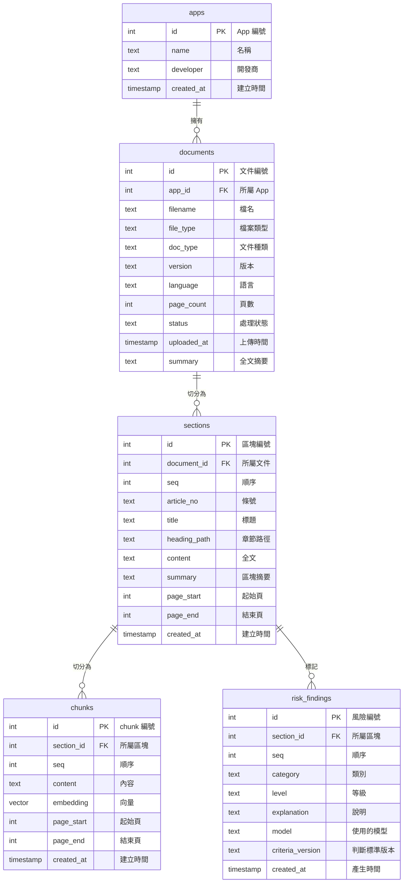

# 資料庫設計

> 說明資料庫有哪些資料表、各欄位的意義，以及資料表之間的關係。決策背景見 [decisions.md](decisions.md) D25。
> 欄位的資料型態、索引與中文全文檢索方式，於實作時（階段 2、3）確定後補上。

## 實體關係圖（ERD）

所有關係皆為一對多：一個 App 有多份文件，一份文件切為多個區塊，一個區塊切為多個 chunk，一個區塊可有零到多筆風險提醒結果。

## 資料表

### apps：App

被分析的條款所屬的服務。

| 欄位 | 說明 |
|---|---|
| `id` | 主鍵 |
| `name` | 名稱，例如「曬圖島」 |
| `developer` | 開發商 |
| `created_at` | 建立時間 |

### documents：文件

一份上傳的條款文件。同一 App 的不同文件種類、不同版本，各為一筆。

| 欄位 | 說明 |
|---|---|
| `id` | 主鍵 |
| `app_id` | 外鍵 → `apps.id` |
| `filename` | 原始檔名 |
| `file_type` | 檔案格式，例如 PDF、DOCX（D15、D16） |
| `doc_type` | 文件種類，例如使用條款、隱私權政策（D15 篩選用） |
| `version` | 文件版本，例如「2026 年 10 月版」 |
| `language` | 語言：中文或英文，決定切塊時辨識條號的規則（D23） |
| `page_count` | 頁數 |
| `status` | 處理狀態：處理中／完成／失敗，供前端顯示進度（D20、P10） |
| `uploaded_at` | 上傳時間 |
| `summary` | 全文摘要（D6）。與文件一對一，直接作為欄位 |

### sections：區塊

一條條文或一個章節，是回答時引用與顯示原文的單位（D5、D6）。

| 欄位 | 說明 |
|---|---|
| `id` | 主鍵 |
| `document_id` | 外鍵 → `documents.id` |
| `seq` | 在文件中的順序 |
| `article_no` | 條號，例如「第 11 條」「Article 5」 |
| `title` | 條文標題，例如「使用者內容之授權」 |
| `heading_path` | 章節路徑，例如「第三章 使用者內容 > 第 11 條」（D19） |
| `content` | 條文全文，供使用者展開核對原文（D14） |
| `summary` | 區塊摘要（D6） |
| `page_start`、`page_end` | 起訖頁碼，跨頁時兩者不同；無頁碼的格式為空值（D19） |
| `created_at` | 建立時間 |

### chunks：chunk

搜尋的基本單位。條文不長時，一個區塊即一個 chunk；超過長度上限時，在條文內以 sliding window 再切（D5）。

| 欄位 | 說明 |
|---|---|
| `id` | 主鍵 |
| `section_id` | 外鍵 → `sections.id` |
| `seq` | 在所屬區塊中的順序 |
| `content` | chunk 文字，供關鍵字搜尋與交給 LLM（D8） |
| `embedding` | bge-m3 向量，1024 維，供向量搜尋（D24） |
| `page_start`、`page_end` | 起訖頁碼（D19） |
| `created_at` | 建立時間 |

D19 的「開頭文字」由 `content` 取前段即可得到，不另存欄位。

### risk_findings：風險提醒結果

條款風險提醒（D17）找出的需注意事項。結果保存下來，避免每次重新呼叫 LLM，也確保前後一致。

| 欄位 | 說明 |
|---|---|
| `id` | 主鍵 |
| `section_id` | 外鍵 → `sections.id` |
| `seq` | 同一區塊中的順序 |
| `category` | 類別，例如「自動續約」 |
| `level` | 等級：高／中／低，標準見 P7 |
| `explanation` | 說明：為什麼值得注意 |
| `model` | 產生此結果的模型 |
| `criteria_version` | 判斷標準版本；標準更新後，可找出需要重新判斷的結果 |
| `created_at` | 產生時間 |

## 設計原則

- **正規化**：每項資料只存一處。例如區塊不另存 App，經由文件即可取得；chunk 不另存文件，經由區塊即可取得。
- **外鍵放在「多」的一方**：例如由 chunk 記錄所屬區塊，而不是由區塊記錄所有 chunk。
- **可推導的資料不另存**：例如 chunk 的開頭文字由內容取得，區塊的 chunk 數量以查詢計算。
