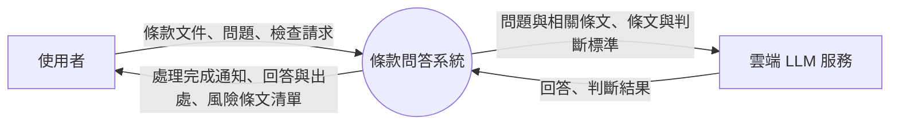
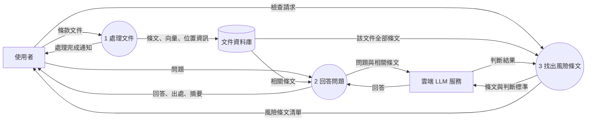

# 資料流程圖（DFD）

> 說明資料從哪裡來、經過哪些處理、存到哪裡、最後交給誰。只描述「做什麼」，不描述使用的技術與執行順序。
> 決策背景見 [decisions.md](decisions.md) D22。

**符號**

| 形狀 | 意義 |
|---|---|
| 方框 | 外部實體：系統以外、與系統交換資料的人或系統 |
| 圓形 | 處理：系統內部對資料所做的事 |
| 圓柱 | 資料儲存 |
| 箭頭 | 資料流，箭頭上標示流動的資料 |

## 環境圖（Context Diagram）

整個系統視為單一處理，只呈現與外部實體交換的資料。

- **雲端 LLM 服務**僅在選擇雲端模式時存在。使用本地模型時，產生回答與判斷皆在系統內部完成，圖上不出現此外部實體。
- 條款文件由使用者自行取得後上傳；系統不直接向條款的發布者擷取文件，因此發布者不在系統邊界內。

## 第 1 層（Level 1）

| 處理 | 說明 |
|---|---|
| 1 處理文件 | 解析上傳的條款文件，依條文切塊、計算向量，連同位置資訊（條號、頁碼）存入資料庫 |
| 2 回答問題 | 以混合搜尋取得與問題相關的條文，交由 LLM 依據條文回答，並附上出處與區塊摘要（RAG） |
| 3 找出風險條文 | 逐條檢視指定文件的全部條文，依判斷標準（P7）列出需注意的條文與原因 |

- 處理 2 以搜尋挑出**部分**相關條文；處理 3 則檢視文件的**全部**條文，兩者取得資料的方式不同。
- 各處理內部的細部步驟（例如處理 1 的解析 → 切塊 → embedding）於後續階段需要時再展開為第 2 層。
